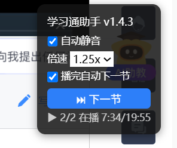

# 学习通视频助手

一个 Tampermonkey 用户脚本，用于**辅助播放**学习通（超星 / chaoxing.com）网课视频与文档任务点。

> ⚠️ 本项目仅做「自动播放 / 静音 / 倍速保持 / 关闭挂机弹窗 / 播完自动下一节 / 文档任务点完成」的**挂机辅助**。**不做自动答题、不代考、不修改任何成绩数据。**

## 功能

- 🎬 自动播放（恢复被暂停的视频）
- 🔇 自动静音
- ⏩ 倍速保持（1x / 1.25x / 1.5x，防页面回退倍速）
- 💤 自动关闭「是否还在学习」挂机弹窗
- ⏭ 视频播完后自动跳下一节
- 📄 文档任务点（PPT / PDF）自动完成
- 🧪 检测到测验 / 作业时自动停下（不代答）
- 🎛 右下角悬浮面板，可实时开关各项

## 安装

1. 安装浏览器扩展 [Tampermonkey](https://www.tampermonkey.net/)。
2. 新建一个用户脚本，删除默认模板，粘贴本仓库的 [学习通视频助手.user.js](学习通视频助手.user.js) 全文。
3. `Ctrl + S` 保存。
4. 打开 / 刷新学习通课程页，右下角出现「学习通助手」面板即生效。

> 提示：若 Tampermonkey 提示「此脚本源无法确定」，点「打开、检验并保存」确认一次即可启用。

## 配置

脚本顶部的 `CFG` 对象可改：

| 键 | 默认值 | 说明 |
| --- | --- | --- |
| `mute` | `true` | 自动静音 |
| `rate` | `1` | 倍速（1 / 1.25 / 1.5） |
| `autoNext` | `true` | 播完自动下一节 |
| `closePopup` | `true` | 关闭挂机弹窗 |
| `waitJobs` | `true` | 跳下一节前等待任务点完成 |
| `finishDocs` | `true` | 自动完成文档任务点 |

> ⚠️ **倍速不建议超过 1.5**：异常倍速会进入学习通的学习行为记录，可能影响成绩认定。

## 说明

- **文档任务点**：学习通文档（PPT / PDF）的「阅读完成」本质上由页面自身的 `finishJob()` 函数上报。本脚本在检测到未完成的文档任务点时调用该函数，等价于正常阅读到最后一页的完成上报。若你不想自动完成文档，把 `CFG.finishDocs` 改为 `false` 即可。
- **测验 / 作业**：脚本检测到任务卡包含 `/work` 或 `/exam` 时会停在当前小节并提示，请自行完成。

## 免责声明

本项目仅供个人学习与浏览器脚本研究使用。请遵守所在学校与平台的相关规定，合理使用。使用本项目产生的任何后果由使用者自行承担。

## License

[MIT](LICENSE)
